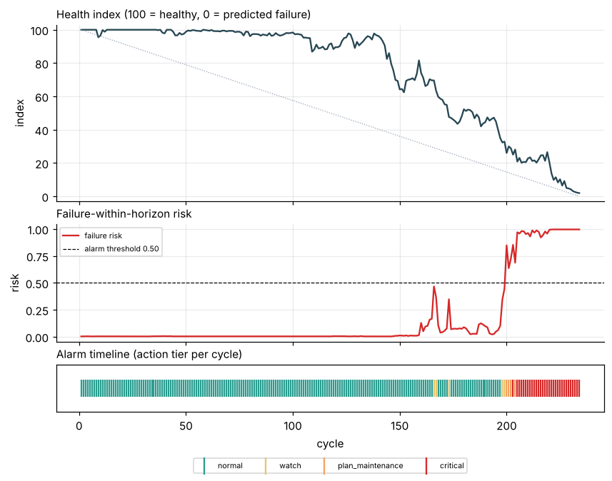
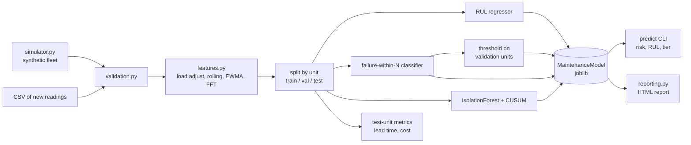
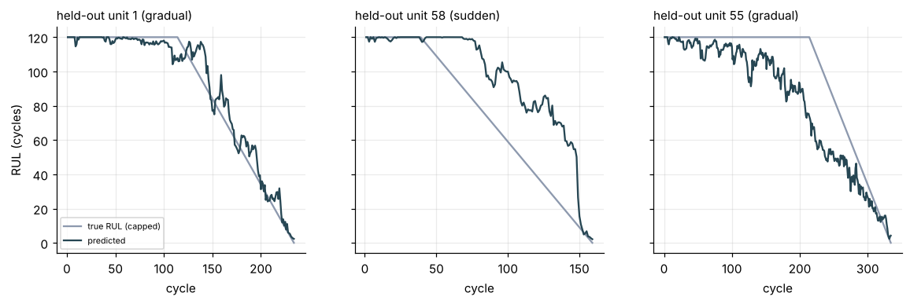
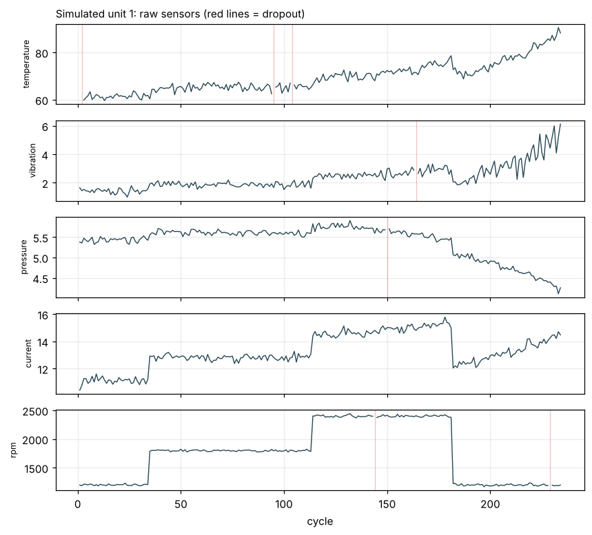
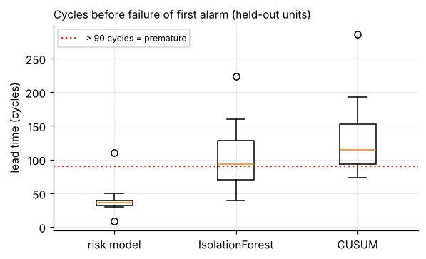
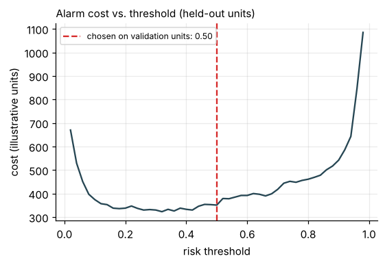
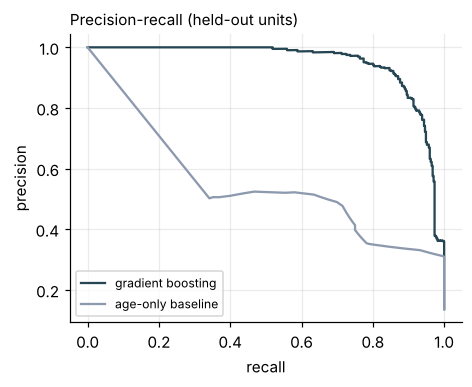
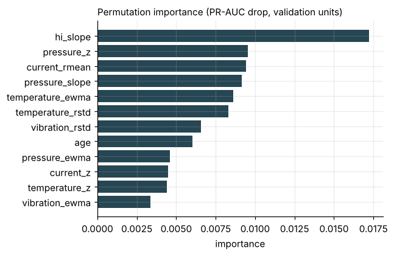

# Predictive Maintenance AI

Predictive maintenance on multivariate sensor time series: a physics-inspired **synthetic** run-to-failure simulator, a validated feature pipeline, remaining-useful-life (RUL) regression, failure-within-N-cycles classification, anomaly detection (IsolationForest + CUSUM), leakage-safe evaluation split **by machine unit**, cost-based alarm thresholds, a `predict` CLI and per-machine HTML reports.

**ملخص بالعربية:** مشروع تعليمي/معرض أعمال للصيانة التنبؤية على سلاسل زمنية من حساسات (حرارة، اهتزاز، ضغط، تيار، سرعة دوران). يولّد محاكي اصطناعي دورات تشغيل حتى العطل (تآكل تدريجي، تغيّر أنظمة التشغيل، فقدان قراءات، أعطال مفاجئة)، ثم يُستخرج منها ميزات نافذية (متوسط/انحراف/ميل/EWMA وطاقة طيفية FFT للاهتزاز)، ويُدرَّب نموذج لتقدير العمر المتبقي (RUL) ونموذج لاحتمال العطل خلال N دورة، مع كشف شذوذ (IsolationForest وCUSUM). التقييم يتم على **وحدات (آلات) كاملة غير مرئية** وليس على صفوف عشوائية، والعتبة تُختار من وحدات التحقق فقط. جميع البيانات **اصطناعية**، والنتائج على بيانات محاكاة متفائلة وليست دليلاً على الأداء الواقعي، ولا يجوز استخدام المشروع لقرارات صيانة حقيقية.



> **Synthetic data only.** No real machine data is used anywhere. Scores below come from a simulator written by the same author as the model, so they are optimistic and are **not** evidence of real-world performance.

## Features

- **Simulator** (`predmaint/simulator.py`): 5 sensors (temperature, vibration, pressure, current, rpm), per-unit random lifetimes, a latent wear variable with nonlinear growth, thermal inertia, 3 rpm operating regimes with dwell times, heteroscedastic noise, a vibration tone that strengthens with wear, single-sample and burst sensor dropout, and ~15 % "sudden-fault" units whose fault appears only 6-18 cycles before failure. Seeded and deterministic.
- **Validation** (`validation.py`): schema, numeric types, infinities, duplicate `(unit, cycle)`, ordering, cycle gaps, missingness, physical ranges; errors raise `DataValidationError`.
- **Causal features** (`features.py`): load (rpm) adjustment fitted on training units only, per-unit healthy baseline, rolling mean / std / least-squares slope, EWMA, a composite health signal, and trailing-window FFT spectral energy (total, tone band, band ratio) of vibration. A test verifies that truncating the future does not change past features.
- **Models** (`evaluation.py`): GradientBoosting (default) or RandomForest for RUL (capped at 120 cycles) and for "fails within 30 cycles"; class imbalance handled with balanced sample weights (GB) or `class_weight` (RF).
- **Anomaly detection** (`anomaly.py`): IsolationForest trained on healthy early-life rows of training units, and an upper CUSUM chart on the composite health signal with its limit chosen on validation units.
- **Leakage-safe evaluation:** train / validation / test are disjoint sets of *machines*; GroupKFold by unit for cross-validation; the alarm threshold is chosen on validation units only; all headline numbers are on test units.
- **Alarm lead time:** cycles before failure of the first alarm, per held-out unit, with a "premature" bucket and a "missed" bucket.
- **Cost analysis:** `cost = c_false_alarm x FP + c_missed x FN` (illustrative units, default 1 : 10), threshold chosen by cost or F1 on validation units, compared on test units.
- **Persistence and CLI:** joblib model bundle, `predict` CLI returning risk score, estimated RUL and action tier; HTML maintenance report with inline base64 charts.

## Architecture



## Quickstart

```bash
python -m pip install -r requirements.txt   # pandas, numpy, scikit-learn, matplotlib, joblib, pytest
python -m pytest -q                         # 25 tests
python scripts/demo.py                      # full experiment; writes PNGs, sample_report.html, metrics.json to docs/

python -m predmaint train --out models/model.joblib            # add --no-cv for a faster run
python -m predmaint simulate --units 4 --seed 99 --strip-labels --out build/new.csv
python -m predmaint predict --model models/model.joblib --input build/new.csv
python -m predmaint report  --model models/model.joblib --input build/new.csv --out build/report.html
```

Input CSV columns for `predict` / `report`: `unit, cycle, temperature, vibration, pressure, current, rpm` (NaN allowed). Include each unit's history from its first cycle, because baselines and rolling features need it.

### Real CLI output

`python -m predmaint train --no-cv` (60 simulated units, seed 42):

```text
Held-out units only (SYNTHETIC data; optimistic, not real-world evidence):
  units train/val/test : 36/12/12
  RUL MAE  model 8.7  vs naive age baseline 18.3 cycles
  RUL RMSE model 14.4  vs naive age baseline 31.3 cycles
  failure<=N cycles    : precision 0.79  recall 0.93  F1 0.86  PR-AUC 0.95 (prevalence 0.14)
  alarm threshold      : 0.50 (chosen on validation units)
  first-alarm lead     : median 35 cycles; missed 0, premature 1 of 12 units
```

`python -m predmaint predict ...` on 4 new simulated units (their full run, so the last row is at failure):

```text
 unit  cycle  risk  est_rul     tier  first_alarm_cycle
    1    224  0.99     3.91 critical                194
    2    203  1.00     2.62 critical                193
    3    238  1.00     2.51 critical                198
    4    261  0.99     3.97 critical                226
```

## Results (simulated data, test units only)

| Metric | Model | Baseline |
|---|---|---|
| RUL MAE / RMSE, all test rows (cycles, RUL capped at 120) | 8.7 / 14.4 | 18.3 / 31.3 (mean training life minus age) |
| RUL MAE, rows within 60 cycles of failure | 7.5 | 27.2 |
| RUL MAE, GroupKFold by unit (4 folds, train+val units) | 8.36 +/- 0.58 | - |
| PR-AUC for "fails within 30 cycles" | 0.95 | 0.46 (age only); prevalence 0.14 |
| Precision / recall / F1 at the chosen threshold 0.50 | 0.79 / 0.93 / 0.86 | - |

Alarm lead time on 12 held-out units (first alarm, cycles before failure):

| Detector | OK | Premature (> 90 cycles early) | Missed | Median lead |
|---|---|---|---|---|
| Risk model (threshold 0.50, 2 consecutive cycles) | 11 | 1 | 0 | 35 |
| IsolationForest | 5 | 7 | 0 | 66 |
| CUSUM (h = 4.5) | 3 | 9 | 0 | 84 |

Cost on test rows (1 per false-alarm row, 10 per missed at-risk row; illustrative):

| Policy | Threshold | False-alarm rows | Missed rows | Cost |
|---|---|---|---|---|
| Cost-optimal on validation units | 0.50 | 91 | 26 | 351 |
| F1-optimal on validation units | 0.92 | 26 | 56 | 586 |
| Never alarm | - | 0 | 372 | 3720 |

Honest reading:

- IsolationForest and CUSUM are **early-drift detectors, not failure predictors**: on these units they mostly fire long before failure, so they are reported as such, not tuned until they look good.
- Only 1 of the 12 test units is a sudden-fault unit, so nothing meaningful can be said about sudden faults from this split. In the RUL plot below, that unit (middle) is estimated far too optimistically until the fault appears.
- The cost-optimal and default 0.5 thresholds coincide here; that is a property of this run, not a general result.
- One run, one seed, 12 test units: differences are indicative, with no confidence intervals.



| | |
|---|---|
|  |  |
|  |  |



A sample per-machine report with inline charts is in [`docs/sample_report.html`](docs/sample_report.html); all metrics are in [`docs/metrics.json`](docs/metrics.json). Both are regenerated by `scripts/demo.py`.

## Project structure

```text
predmaint/
  config.py       dataclass configs, logging setup
  simulator.py    synthetic run-to-failure fleet
  validation.py   input checks
  features.py     causal windowed features, FFT proxies
  anomaly.py      CUSUM, IsolationForest wrapper
  evaluation.py   unit-level split, estimators, metrics, lead time, cost curve
  model.py        MaintenanceModel bundle, action tiers, joblib save/load
  pipeline.py     end-to-end leakage-safe experiment
  reporting.py    matplotlib charts, HTML report
  cli.py          simulate / train / predict / report
scripts/demo.py   regenerates docs/
tests/            25 pytest tests
```

## Testing

`python -m pytest -q` runs 25 tests on small simulated fleets (a few seconds): simulator determinism and labels, validation errors and warnings, feature causality (truncation test) and label exclusion, FFT tone response, CUSUM, unit-disjoint splits, class weights, alarm persistence and lead time, cost-ratio effect on thresholds, validation-only threshold selection, beating the naive baseline on held-out units, joblib round trip, action tiers, GB and RF training, HTML report content and CLI end to end.

## Limitations

- **All data is synthetic**, produced by a simulator the model's author wrote. The model can exploit its simplifications (smooth monotone wear, known sensor couplings). Real machines have far messier physics, labels, maintenance interventions and censoring.
- **Scores on simulated data are optimistic and are not evidence of real-world performance.** No real validation was done.
- **Must not drive real maintenance decisions.** Action tiers and the cost ratio are illustrative; no safety analysis was done.
- Small experiment (60 units, 12 test units, one seed); no confidence intervals; hyperparameters not tuned.
- Sudden faults are barely represented in the test split and are hard for this approach; alarms for them come late.
- RUL is capped at 120 cycles; features need each unit's history from its first cycle; units are assumed run-to-failure with no repairs.
- The FFT "spectral energy" feature is a proxy on one sample per cycle, not a real high-rate vibration analysis.

## Roadmap

- Multiple seeds and confidence intervals; sudden-fault-focused test set.
- Survival / censored-data handling for machines that never failed.
- Calibrated probabilities and a proper alarm-fatigue analysis.
- Evaluation on a public real-world run-to-failure dataset (not done here).

## Built with AI assistance

This project was built with AI assistance (Claude). The author directed the scope and is responsible for the repository; the code, tests and numbers above were produced by running it, but it should be reviewed before being relied on for anything.

## License

MIT, see [LICENSE](LICENSE). Copyright (c) 2026 Aymen Al Erwi.
